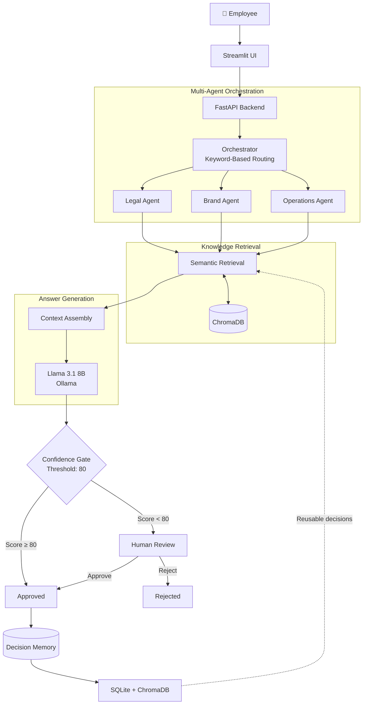
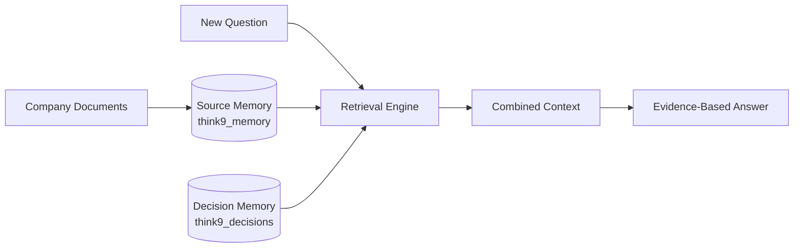
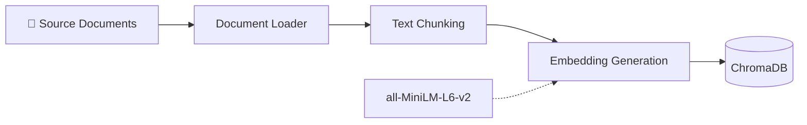

# 🧠 Think9 Brain

<p align="center">
  <strong>A Multi-Agent Knowledge Assistant with RAG, Human Review & Persistent Decision Memory</strong>
</p>

<p align="center">
  
  
  
  
  
</p>

<p align="center">
  <a href="https://github.com/Sumanth3036/Think9-Multi-Agent-Knowledge-Assistant">
    
  </a>
  
</p>

---

> **Ask → Retrieve → Answer → Review → Remember**
>
> Think9 Brain transforms scattered company knowledge into evidence-backed answers through specialist AI agents, semantic retrieval, confidence-based validation, and human-approved decision memory.

**Project status:** A working prototype demonstrating the architecture and workflow, not a production system. See [Scope and Limitations](#-scope-and-limitations).

---

## 💡 The Idea

Company knowledge is distributed across legal playbooks, brand histories, operations notes, and previous business decisions.

Finding the right information is only part of the problem. Employees also need reliable answers, supporting evidence, and a way to preserve decisions that have already been reviewed.

Think9 Brain brings these steps into one workflow:

- **Specialist agents** identify the relevant knowledge domain.
- **RAG retrieval** finds supporting information from company documents.
- **LLM synthesis** generates answers grounded in retrieved evidence.
- **Confidence validation** determines whether human review is required.
- **Decision memory** preserves approved answers for future use.

### Example Interaction

| Stage | Example |
|---|---|
| 💬 Question | What are the rules for two-for-one promotions? |
| 📚 Retrieved evidence | `legal_playbook.txt` |
| 🤖 AI response | Generates an answer using retrieved document evidence |
| 🎯 Validation | Assigns a confidence score |
| 👤 Decision | Automatically approved or sent for human review |
| 🧠 Memory | Approved decision becomes reusable knowledge |

---

## ⚙️ System Architecture

Think9 uses a modular multi-agent architecture. Each specialist agent handles a knowledge domain, while the orchestrator manages retrieval, synthesis, validation, and decision storage.



### Workflow Breakdown

| Stage | Component | Responsibility |
|---|---|---|
| 01 | Streamlit | Accepts employee questions |
| 02 | Orchestrator | Routes questions to Legal, Brand, and Operations agents using keyword rules |
| 03 | Retrieval | Searches ChromaDB for relevant document chunks using semantic similarity and category filters |
| 04 | Synthesis | Llama 3.1 8B generates answers using retrieved evidence and source references |
| 05 | Confidence Gate | Routes answers according to the configured confidence threshold |
| 06 | Human Review | Allows reviewers to approve or reject uncertain answers |
| 07 | Decision Memory | Stores decisions for reuse in similar future questions |

**Important:** The confidence score controls workflow routing; it does not guarantee answer correctness.

---

## 🧠 Two-Layer Knowledge Memory

Think9 separates original company knowledge from human-approved decisions.



| Memory Layer | Collection | Purpose |
|---|---|---|
| Source Memory | `think9_memory` | Stores legal playbooks, brand histories, vendor decisions, and meeting notes |
| Decision Memory | `think9_decisions` | Stores answers that have been reviewed and approved |

**Why this matters**

Source memory provides the original evidence. Decision memory preserves conclusions that a person has signed off on.

For example, a later question such as *"Can we use the same promotion structure?"* can retrieve an earlier approved decision concerning a Brand A two-for-one promotion.

Each decision record in SQLite stores:

- Original question and generated answer
- Confidence score and categories
- Supporting sources
- Review status (`approved`, `pending_review`, or `rejected`)
- Creation timestamp

---

## 📥 Knowledge Ingestion Pipeline

Documents are converted into searchable vector representations before they become available to the agents.



**Ingestion process:**

1. Load company knowledge documents.
2. Split documents into smaller text chunks.
3. Generate embeddings using Sentence Transformers.
4. Store embeddings and metadata in ChromaDB.
5. Retrieve relevant chunks when users submit questions.

The embedding model runs locally and can work offline after the model is cached.

---

## 🛠️ Technology Stack

<p align="center">
  
</p>

| Layer | Technologies |
|---|---|
| Frontend | Streamlit |
| Backend | FastAPI, Pydantic |
| LLM | Llama 3.1 8B, Ollama |
| Retrieval | ChromaDB, Sentence Transformers |
| Embeddings | all-MiniLM-L6-v2 |
| Storage | SQLite, SQLAlchemy |
| Testing | Pytest |
| Architecture | Multi-Agent Systems, RAG, Human-in-the-Loop |

---

## 🚀 Getting Started

### Prerequisites

- Python 3.10+
- Git
- [Ollama](https://ollama.com/)

### 1. Clone the Repository

```bash
git clone https://github.com/Sumanth3036/Think9-Multi-Agent-Knowledge-Assistant.git

cd Think9-Multi-Agent-Knowledge-Assistant
```

### 2. Download the LLM

```bash
ollama pull llama3.1:8b
```

### 3. Install Dependencies

```bash
pip install -r requirements.txt
```

### 4. Ingest Sample Documents

```bash
python -m app.ingestion.run_ingestion
```

### 5. Start the Backend

```bash
uvicorn app.main:app --reload
```

### 6. Launch the Frontend

Open another terminal:

```bash
streamlit run frontend/app.py
```

**Access the application:**

| Service | URL |
|---|---|
| FastAPI Documentation | http://localhost:8000/docs |
| Streamlit Interface | http://localhost:8501 |

---

## 🧪 Testing

The test suite covers individual components and the end-to-end application workflow.

| Test Area | Coverage |
|---|---|
| Ingestion | Document loading, chunking, and embeddings |
| Retrieval | Semantic search and document retrieval |
| Agents | Specialist agents and orchestration |
| Synthesis | Evidence-based response generation |
| Confidence Gate | Confidence evaluation and routing |
| Decision Memory | Decision persistence and retrieval |
| Human Review | Approval and rejection workflow |
| API | End-to-end request handling |

Run the complete test suite:

```bash
pytest tests/
```

Relevant test modules:

- `tests/test_api.py`
- `tests/test_phase11.py`

---

## 📁 Project Structure

```text
Think9/
│
├── app/
│   ├── agents/
│   │   ├── orchestrator
│   │   ├── legal_agent
│   │   ├── brand_agent
│   │   ├── operations_agent
│   │   ├── synthesizer
│   │   └── confidence_gate
│   │
│   ├── ingestion/
│   │   ├── loader
│   │   ├── chunker
│   │   ├── embedder
│   │   └── run_ingestion
│   │
│   ├── retrieval/
│   ├── memory/
│   ├── review/
│   ├── models/
│   ├── graph.py
│   └── main.py
│
├── frontend/
│   └── app.py
│
├── data/
├── tests/
├── requirements.txt
└── README.md
```

---

## ⚠️ Scope and Limitations

Think9 Brain is a working prototype. Its current limitations include:

- **Keyword-based routing:** Specialist agents are selected using keyword rules, not semantic or LLM-based routing.
- **Confidence is not correctness:** The confidence threshold determines answer routing, not factual accuracy.
- **No model retraining:** Approved decisions are stored and reused as memory; the model does not learn or retrain from them.
- **Local inference:** Requires Ollama with `llama3.1:8b` running locally.
- **Limited knowledge base:** Currently operates on a small sample dataset.
- **Prototype storage:** Uses SQLite and local ChromaDB rather than production-grade infrastructure.
- **Basic review workflow:** Supports approval and rejection without advanced roles or permissions.

---

## 🗺️ Roadmap

- [ ] Semantic and LLM-based agent routing
- [ ] PDF, DOCX, email, and transcript ingestion
- [ ] Role-based access control
- [ ] Production-grade database infrastructure
- [ ] Answer quality and retrieval quality monitoring
- [ ] Review-rate and latency analytics
- [ ] Benchmark dataset with expected evidence
- [ ] Advanced reviewer workflows

---

## 👨‍💻 Author

**Sumanth Ponugupati**

AI Engineering · Backend Development · LLM Applications

<p align="left">
  <a href="https://www.linkedin.com/in/sumanthponugupati/">
    
  </a>
  <a href="https://sumanth3036.github.io/my-portfolio/">
    
  </a>
  <a href="https://github.com/Sumanth3036">
    
  </a>
</p>

<p align="center">
  <b>Building intelligent systems that retrieve, validate, and remember.</b>
</p>
